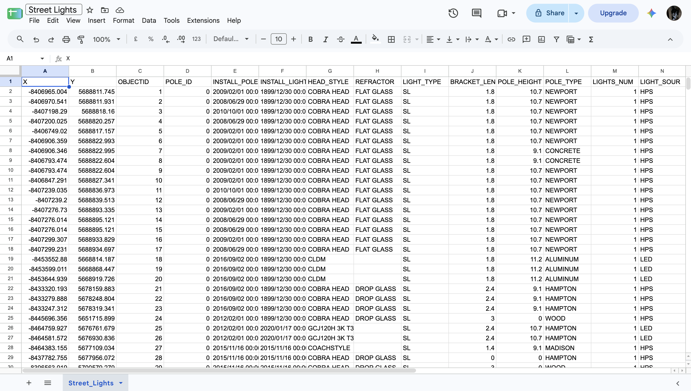
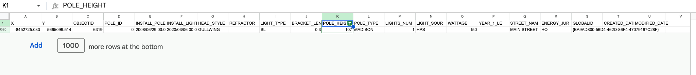
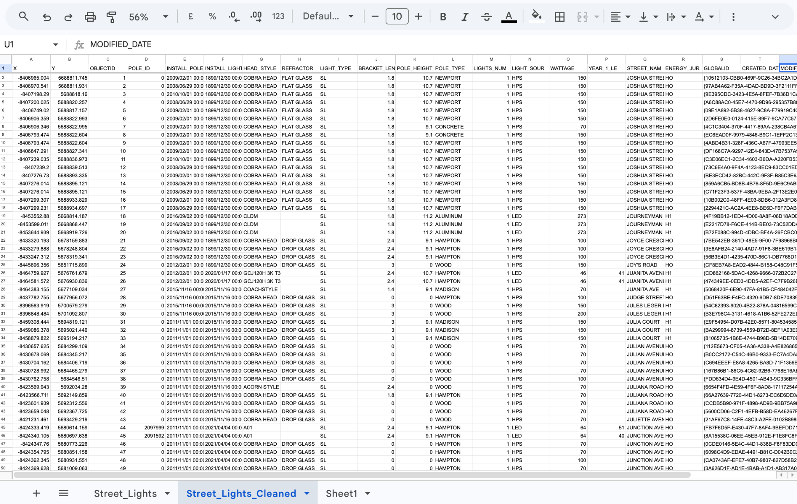
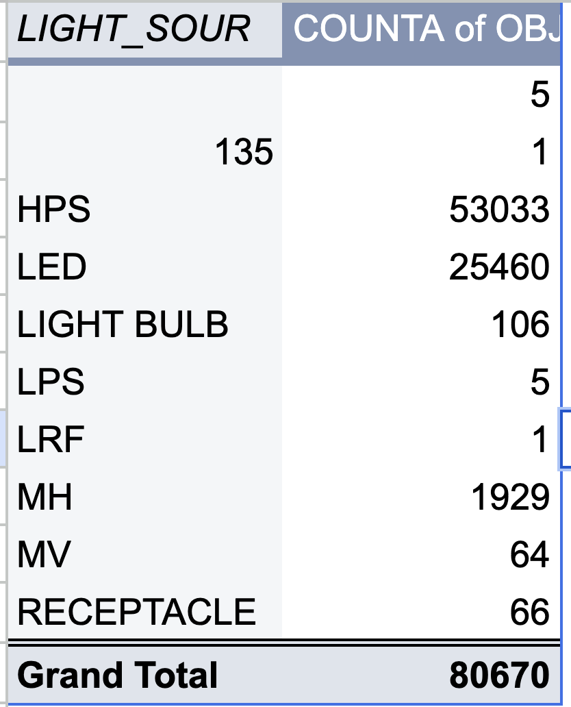
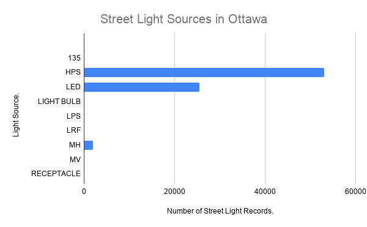

**November 5, 2026**<br>
**MPAD 2003A – Introductory Data Storytelling**<br>
**Ayesha Hussain**<br>
**Presented to Jean-Sébastien Marier**<br>

# Deliverable 2: Exploratory Data Analysis (EDA)


## 1. Getting Data
For this assignment, I will be analyzing the City of Ottawa's [Street Lights dataset](https://open.ottawa.ca/datasets/street-lights/about) from the Open Ottawa data portal (City of Ottawa, 2019). My story focuses on street lighting in Ottawa, especially in areas where people might be walking alone or taking public transit at night. I wanted to see what kinds of street lights are being used throughout the city and whether or not there are any patterns that are worth looking into.

I found the dataset by searching the term 'Street Lights' on the Open Ottawa data portal. I downloaded the data as a CSV file and imported it into Google Sheets by going to File, Import, Upload, then selecting the file. The link to the spreadsheet can be found [here](https://docs.google.com/spreadsheets/d/12CwZ0jz5Pu-L2EY8kiHbW2zAw3cVcyki4Zd8j9Lw20I/edit?usp=sharing).




*Figure 1: The City of Ottawa Street Lights dataset after importing it into Google Sheets.*

The data set has 80,670 data rows and 21 columns, not including the header row. As I was looking through it, I noticed a few things that looked unusual, like empty cells under the REFRACTOR section, some pole heights being listed as zero, and some installation dates saying they were from December 30th, 1899. I'm not sure why they're listed like that, so I'll have to look into them when cleaning the data.

Three columns that stood out to me were LIGHT_SOUR, POLE_HEIGHT, and HEAD_STYLE. LIGHT_SOUR shows the different types of light sources, like LED and HPS, which are nominal categorical variables. POLE_HEIGHT contains the numerical measurements of pole heights, making it a continuous numerical variable. Lastly, HEAD_STYLE shows the different styles of light fixtures, like COBRA HEAD and CLDM, which are also nominal categorical variables.

A question I want to explore is whether LED or HPS lights are more common on certain streets in Ottawa.


## 2. Understanding Data

### 2.1. VIMO Analysis

Before cleaning the dataset, I completed a VIMO analysis to check for valid, invalid, missing, and outlier values. According to Statistics Canada (2020), VIMO helps identify potential errors in a dataset. I focused on the 'LIGHT_SOUR' and 'POLE_HEIGHT' columns because they're relevant to my story.

**Valid:** I used the filter tool on Google Sheets to look through the 'LIGHT_SOUR' column. I found several types of light sources, including HPS, LED, MH, LPS, and MV. Since these are recognizable types of lighting, the values appeared valid. However, this doesn't guarantee that all the values were recorded correctly.

**Invalid:** While looking through the light sources filter, I found one entry listed as '135' in row 76070. The same row had a wattage of zero and a pole height of 11.2. Since '135' doesn't match the other light source categories, it could be an error. However, I cannot assume what the correct value should be.

**Missing:** I noticed some empty cells under `LIGHT_SOUR`. To find out how many were missing, I used the 'COUNTBLANK' function in Google Sheets:

```excel 
=COUNTBLANK(Street_Lights!N2:N80671)
```

The formula returned five blank cells out of 80,670 entries. This means five records don't specify what type of light source is being used.

**Outliers:** I sorted the `POLE_HEIGHT` column from smallest to largest and found that the lowest height was zero, while the highest was 107. To see how often these values appeared, I used the following formulas:

```excel
=COUNTIF(Street_Lights!K2:K80671,0)
```

```excel
=COUNTIF(Street_Lights!K2:K80671,107)
```

I found 25,889 entries with a height of zero and only one with a height of 107. The entry with a height of 107 was an HPS light on Main Street with a wattage of 150. Since many of the other heights were around 9 to 11, I thought 107 might have been meant to be 10.7, but I can't confirm that. The zero values could just be missing measurements rather than the actual height of the poles.




*Figure 2: A street light on Main Street with a recorded pole height of 107.*


### 2.2. Cleaning Data

After completing my VIMO analysis, I started cleaning the dataset in Google Sheets. I first duplicated the original sheet and renamed it `Street_Lights_Cleaned` so I could keep the untouched data.

I then used Find and Replace. I noticed that seven entries under `LIGHT_SOUR` had `led` written in lowercase instead of `LED`. I selected the column, went to Edit > Find and replace, and replaced the entries with `LED` to keep the labels consistent.

Next, I went to Data > Data cleanup > Trim whitespace to check for unnecessary spaces. Google Sheets reported there were no extra spaces in the `LIGHT_SOUR` column. However, when I checked the rest of the dataset, it found unnecessary spaces in 2,589 cells, including some street names. I used the Trim all option to remove them.

I also froze the first row using View > Freeze > 1 row so the column headings would stay visible while scrolling through the dataset.

Lastly, I checked for duplicates using Data > Data cleanup > Remove duplicates. I selected all 21 columns and checked that the data had a header row. Google Sheets reported that no duplicate rows were found, so all the data rows remained.

I left the unusual values I found during my VIMO analysis unchanged because I couldn't be sure what the correct values should be.


*Figure 3: The Street Lights dataset in Google Sheets after completing the cleaning process.*


### 2.3. Analyzing Data

Once I cleaned the dataset, I wanted to see what kinds of street lights were used most commonly throughout Ottawa. I focused on the `LIGHT_SOUR` column so I could compare LED and HPS lights to see which was more common.

I did this by creating a pivot table in Google Sheets by going to Insert > Pivot table. Using the cleaned version of the dataset, I added `LIGHT_SOUR` under Rows and `OBJECTID` under Values. After that, I changed the calculation to `COUNTA` so I could count how many entries there were for each type of light source.



*Figure 4: Pivot table showing the number of records for each light source in Ottawa.*

The pivot table showed me that HPS was the most common light source, with 53,033 entries, followed by LED with 25,460 and MH with 1,929. I then used the Chart tool to create a bar chart to compare the different light sources. I chose a bar chart because I thought that would make it easier to visually see the differences between the categories.



*Figure 5: Bar chart showing the distribution of street light sources in Ottawa.*

The chart shows that HPS was more common than LED. I also wanted to know what percentage of the dataset each type made up. I calculated this by dividing the number of entries for each light source by the total number of records (80,670) and multiplying it by 100. For HPS, it was 65.7% ((53,033 ÷ 80,670) × 100), and for LED, it was 31.6% ((25,460 ÷ 80,670) × 100).

This tells me that HPS is the most common overall, but it doesn't tell me the specifics of which streets they're on. I would want to look into this further, especially in areas around universities, transit stations, and downtown Ottawa, since those are the main focuses of my story.


## 3. Delivering Data

After going through everything, I think my dataset has the potential to tell a story about street lighting in Ottawa, especially when it comes to people walking or taking public transit at night. My analysis showed that HPS lights were more common than LED lights, but I still don't know how these lights are distributed across different areas of the city.

For my story, I want to hone in on areas around universities, transit stations, and downtown Ottawa. I would like to compare the types of street lights and see if there are any noticeable patterns. I could use the `STREET_NAM` column to start comparing different streets, although I would need more location information to look at specific areas.

I would also want to find out whether the differences in lighting affect how safe people feel when walking alone at night. Since the data is only about the street lights themselves, I would need to gather other information, like people's experiences and observations of lighting in these areas.

I could interview students who regularly travel home after evening classes or people who use public transit at night. I would also like to speak with someone from the City of Ottawa who could explain how decisions about street lighting are made.

For the final story, I could use maps, charts, photographs, and interviews to show how street lighting varies throughout Ottawa and how people experience these spaces at night.


## 4. References

City of Ottawa. (2019, August 29). *Street lights* [Data set; updated August 12, 2026]. Open Ottawa. https://open.ottawa.ca/datasets/street-lights/about

Statistics Canada. (2020, September 23). *Data accuracy and validation: Methods to ensure the quality of data* [Video]. https://www.statcan.gc.ca/en/wtc/data-literacy/catalogue/892000062020008


